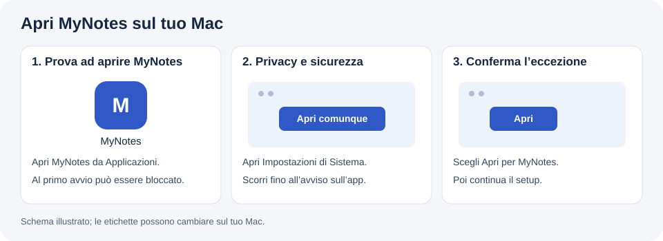

# MyNotes + Capture

Registra le lezioni e trasforma audio, slide e appunti personali in dispense Word con formule modificabili. Capture è incluso: non serve scaricarlo separatamente.

Italiano | [English](README.md)

## MyNotes per Mac

**Mac Apple Silicon (M1 o successivo), macOS 14+, internet per il setup e un account utilizzabile con Codex, Agy o Claude Code CLI.**

**Il nuovo DMG è un candidato di sviluppo e non è ancora pubblicato.** [GitHub Releases](https://github.com/gabrizanni/mynotes/releases) contiene le release precedenti; uno ZIP precedente non include questo setup. Il collegamento diretto al DMG verrà aggiunto dopo l’approvazione della release.

Quando il DMG sarà disponibile:

1. Apri il file `.dmg` scaricato.
2. Trascina **MyNotes** in **Applicazioni**.
3. Apri **MyNotes**, segui il setup e premi **Apri la chat**.

Il setup prepara Python, trascrizione locale e strumenti Word. Non devi installare prima Python, Homebrew o Xcode. Scegli Codex, Agy o Claude Code: se manca, MyNotes apre la guida ufficiale per installarlo e ti invita a ricontrollare. Accesso ed eventuale abbonamento dipendono dal provider.

Per Claude Code serve un piano abilitato oppure accesso API con crediti: l’account Claude Free non include la CLI, anche usando Haiku. [Piani Claude](https://claude.com/pricing).

### Se macOS blocca l’apertura

Questo candidato non è notarizzato da Apple e usa una firma ad-hoc. Dopo aver provato ad aprire MyNotes, vai in **Impostazioni di Sistema → Privacy e sicurezza**, scorri fino all’avviso sull’app bloccata, scegli **Apri comunque** e conferma **Apri**. Le etichette possono cambiare tra versioni macOS o sui Mac gestiti. [Guida Apple](https://support.apple.com/it-it/102445).



[Installazione e problemi comuni](docs/INSTALL.it.md) · [Primo utilizzo](docs/ONBOARDING.md)

## La prima conversazione

Prima di aprire la chat scegli la lingua e, se vuoi, il modello nell’app: la scelta vale per chat e appunti. MyNotes si presenta brevemente e chiede il tuo background. Poi pone insieme due domande sul contesto del corso e sullo stile degli appunti; rispondi con un unico messaggio libero. Le preferenze del corso vengono salvate e riutilizzate nelle lezioni successive. Infine collega audio e materiali. Puoi trascinare i file nel Terminale. MyNotes propone `~/Documents/MyNotes` per registrazioni, materiali e dispense. Configurazione privata e database restano in Application Support. Puoi collegare cartelle esistenti senza spostarne i contenuti.

Parti con qualità **standard** e stile integrato. Le preferenze si cambiano quando servono; nomi dei modelli e livelli di ragionamento sono facoltativi.

Nella scheda MyNotes, **Aggiorna modelli** legge il catalogo della CLI dell’agente
scelto. Nuovi modelli ed effort compaiono senza una nuova versione di MyNotes,
quando il provider li espone alla CLI. I preset restano scorciatoie separate.
**Salva scelta** conserva la coppia per le prossime chat e generazioni.
[Dettagli del catalogo dinamico](docs/MODEL-CATALOG.md).

Per registrare, scrivi **“Ecco il calendario, configura le registrazioni.”** L’agente mostra le lezioni, chiede conferma della pianificazione e guida al permesso microfono e a una breve prova con riascolto. Capture resta disattivato finché non lo abiliti. Il test è completo quando il file audio è valido e confermi che si sente.

Capture registra anche a chat chiusa: il Mac deve essere acceso e sveglio, con il coperchio aperto. Salva gli audio senza generare automaticamente appunti. [Comandi e limiti di Capture](docs/CAPTURE.md).

Chiedi **“Prepara gli appunti della prima lezione usando questo audio e queste slide.”** L’agente prepara le fonti, genera il candidato, costruisce e verifica il Word, poi mostra l’anteprima. Approva il candidato prima che venga inserito nella dispensa del corso.

In seguito riapri MyNotes oppure usa:

```sh
mynotes          # agente scelto
mynotes codex
mynotes agy
mynotes claude
mynotes setup   # riapri il setup
mynotes doctor --json
```

## Dove vanno i tuoi dati

Registrazione e trascrizione avvengono sul Mac. La generazione può inviare testo della trascrizione, materiali selezionati e immagini rilevanti al provider AI attraverso la sua CLI. Si applicano account, permessi, politiche ed eventuali costi del provider. MyNotes non crea un proprio account e non salva le credenziali del provider nella configurazione dei corsi. [Privacy](docs/PRIVACY.md).

## Per sviluppatori

```sh
git clone https://github.com/gabrizanni/mynotes.git
cd mynotes
uv sync --locked
uv run pytest
uv run python scripts/check_public_tree.py
uv run python scripts/build_dmg.py
```

Gli strumenti di compilazione servono solo sul computer che crea il pacchetto. Il builder compila setup nativo, Capture ed eseguibile di trascrizione e include i file di runtime con versioni bloccate. L’utente installa il risultato compilato.

La pipeline è `prepare → generate → build → publish`: conserva provenienza delle fonti, usa contratti JSON per i candidati, crea formule Word modificabili e protegge la pubblicazione da modifiche concorrenti e lezioni duplicate. [Script](scripts/README.md) · [Verifiche effettuate e mancanti](docs/VALIDATION.md) · [Aggiornamenti e rollback](docs/UPDATES.md).

[Licenza MIT](LICENSE) · [Licenze di terze parti](THIRD_PARTY_NOTICES.md) · [Gabriele Zanni](https://github.com/gabrizanni)
