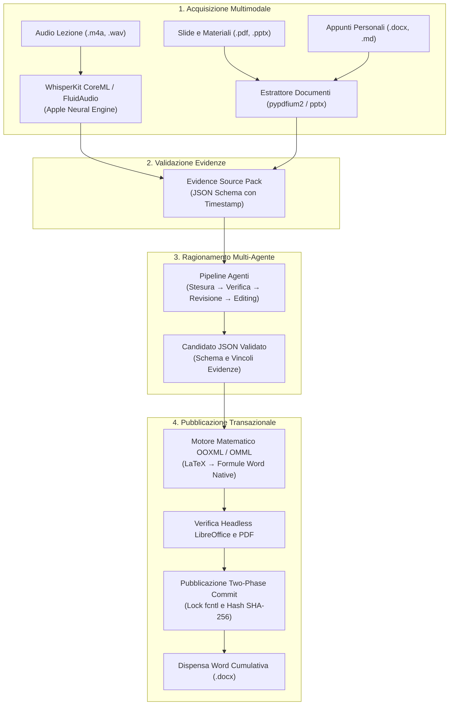

# MyNotes

> Assistente AI agentico local-first e motore transazionale di pubblicazione Word per macOS.

[]()
[]()
[-black.svg)]()
[]()
[]()

Guida in italiano | English documentation: [README.md](README.md)

---

## Panoramica

Trasformare le lezioni universitarie in dispense di studio complete e rigorose è un processo complesso: richiede di combinare ore di registrazioni audio, slide dense (PDF/PPTX), appunti personali e formule matematiche articolate.

I software convenzionali spesso inventano citazioni (allucinazioni), degradano le formule matematiche in immagini sgranate, inviano l'audio privato su server cloud terzi o sovrascrivono inavvertitamente le modifiche manuali degli studenti.

**MyNotes** risolve queste criticità con una pipeline rigorosa, orientata alla privacy e nativa per macOS. Il tool elabora input multimodali, allinea le evidenze empiriche, orchestra il ragionamento multi-agente con contratti JSON verificabili e pubblica dispense in formato Microsoft Word contenenti equazioni vettoriali native e modificabili.

---

## Architettura



---

## Pilastri Ingegneristici

### 1. Edge AI e Riconoscimento Vocale On-Device (Apple Silicon)
- Basato su **WhisperKit** in esecuzione diretta sull'**Apple Neural Engine (CoreML)** e **FluidAudio**.
- Nessun dato inviato al cloud: l'audio e le trascrizioni rimangono esclusivamente sul tuo computer.
- Supporto per vocabolario personalizzato del corso, normalizzazione con `afconvert` di macOS e timestamp a livello di singola parola.

### 2. Pipeline di Ragionamento Multi-Agente
- Integrazione diretta con i runtime locali (Codex, Antigravity) tramite contratti JSON Schema convalidati.
- **Quattro livelli di qualità selezionabili:**
  - `base`: sintesi a singolo passaggio con contesto mirato.
  - `standard`: sintesi approfondita del contesto della lezione.
  - `approfondito`: bozza estesa con revisione mirata tra agenti.
  - `revisione`: flusso completo comprendente stesura, audit formale delle citazioni e revisione editoriale.
- Ogni affermazione generata mappa a specifici identificatori di evidenza (`T001` per audio, `S005` per slide, `H002` per dispense).

### 3. Motore Matematico OOXML Nativo (da LaTeX a OMML)
- Implementa un parser dedicato che converte le espressioni LaTeX direttamente in linguaggio **Office Math Markup Language (`m:oMath`)**.
- Produce formule vettoriali native, nitide e modificabili direttamente con l'editor di equazioni di Microsoft Word, evitando l'uso di immagini statiche.

### 4. Pubblicazione Transazionale Two-Phase Commit
- Gestione della concorrenza tramite file locking POSIX consultivo (`fcntl`).
- Calcolo degli hash di integrità crittografica SHA-256 prima e dopo la modifica per rilevare eventuali modifiche esterne, preservando le note manuali scritte dallo studente al di fuori dei blocchi di lezione.
- Giornale delle transazioni e rollback automatico in caso di interruzioni impreviste.

---

## Guida Rapida per Sviluppatori

Clonare e verificare il progetto richiede meno di un minuto utilizzando [uv](https://docs.astral.sh/uv/):

```sh
# 1. Clona il repository
git clone https://github.com/gabrizanni/mynotes.git
cd mynotes

# 2. Sincronizza le dipendenze in <3 secondi
uv sync

# 3. Esegui la suite di test completa (52 test)
uv run pytest

# 4. Esegui il test end-to-end della pipeline Word
uv run python scripts/validate_word_pipeline.py /tmp/mynotes-demo
```

---

## Flusso dei Comandi CLI

MyNotes separa rigorosamente il codice dell'applicazione dallo spazio di lavoro privato dell'utente. Tutti i file, le registrazioni e i documenti Word risiedono in una cartella esterna dedicata.

```sh
# 1. Inizializza lo spazio di lavoro privato
mynotes configure --workspace "~/Documents/MyNotes-Workspace"

# 2. Elabora i materiali e crea il source pack per la lezione
mynotes prepare CS101-L01 \
  --workspace "~/Documents/MyNotes-Workspace" \
  --material "~/Courses/CS101/slides.pdf" \
  --personal-notes "~/Courses/CS101/notes.docx"

# 3. Genera la bozza con il provider configurato (Codex o Antigravity)
mynotes generate CS101-L01 --workspace "~/Documents/MyNotes-Workspace" --provider agy --quality standard

# 4. Compila e valida la bozza in formato Word
mynotes build CS101-L01 --workspace "~/Documents/MyNotes-Workspace"

# 5. Pubblica atomicamente nella dispensa cumulativa del corso
mynotes publish CS101-L01 --workspace "~/Documents/MyNotes-Workspace"

# Ispeziona lo storico delle pubblicazioni e lo stato
mynotes history CS101 --workspace "~/Documents/MyNotes-Workspace"
mynotes status --workspace "~/Documents/MyNotes-Workspace"
```

---

## Installazione Utente Finale

Per installare MyNotes come applicazione autonoma senza configurare l'ambiente di sviluppo, scarica l'archivio compilato da [GitHub Releases](https://github.com/gabrizanni/mynotes/releases):

```sh
zsh scripts/install-mynotes.sh
mynotes doctor
```

Lo script verifica l'ambiente, Python 3.12+ e installa i file dell'applicazione in `~/Library/Application Support/MyNotes/app/` con il launcher in `~/.local/bin/`.

---

## Sicurezza e Sovranità dei Dati

- **Architettura Local-First:** Tutti i materiali di studio, le registrazioni audio e i documenti Word rimangono sempre all'interno dello spazio di lavoro locale.
- **Autenticazione Provider:** I provider AI esterni sfruttano i propri flussi di autenticazione CLI. MyNotes non richiede né memorizza token o chiavi API nei propri file di configurazione.
- **Licenze di Terze Parti:** Consulta [THIRD_PARTY_NOTICES.md](THIRD_PARTY_NOTICES.md) per i dettagli sulle librerie open source utilizzate.

---

## Licenza e Autore

- **Licenza:** [Licenza MIT](LICENSE)
- **Autore:** Sviluppato da [Gabriele Zanni](https://github.com/gabrizanni).
