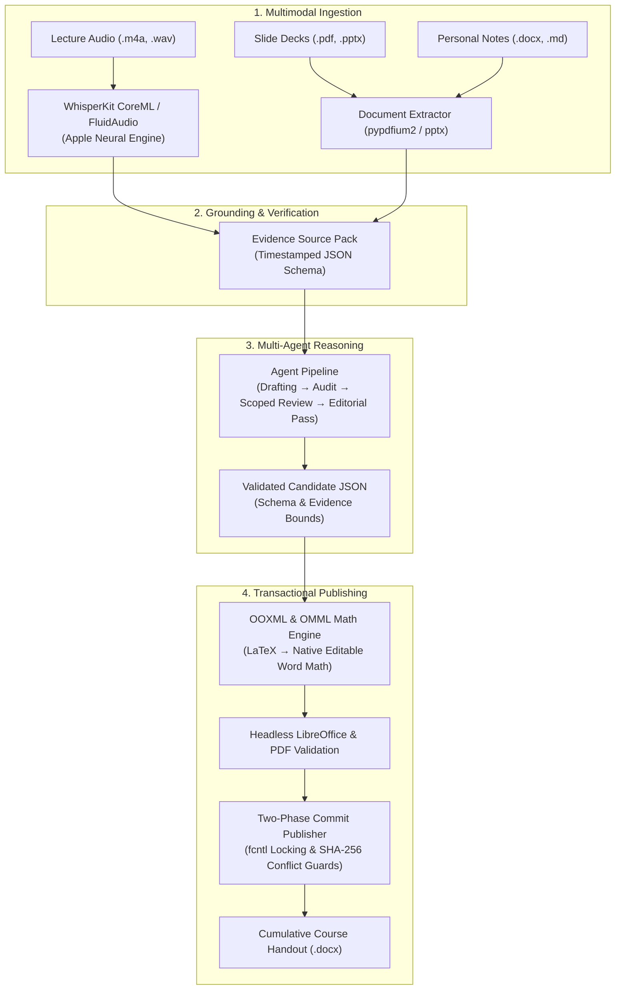

# MyNotes

> Local-first, multi-agent AI lecture synthesizer and transactional Word publishing engine for macOS.

[]()
[]()
[-black.svg)]()
[]()
[]()

English documentation | Guida in italiano: [README.it.md](README.it.md)

---

## Overview

Transforming university lectures into comprehensive, rigorous study notes is a complex workflow: students must integrate hours of spoken audio, dense slide decks, personal lecture notes, and intricate mathematical formulas. 

Existing tools frequently hallucinate citations, compress mathematical equations into low-resolution raster images, leak confidential classroom audio to cloud servers, or accidentally overwrite manual student edits.

**MyNotes** solves this with an on-device, privacy-preserving, mathematically rigorous pipeline built natively for macOS. It processes multimodal lecture inputs, extracts and aligns structural evidence, orchestrates multi-agent LLM reasoning through verifiable contracts, and transactionally publishes publication-grade Microsoft Word handouts containing native, editable equations.

---

## Architecture



---

## Core Engineering Highlights

### 1. Edge AI & On-Device Speech (Apple Silicon)
- Powered by **WhisperKit** running natively on the **Apple Neural Engine (CoreML)** and **FluidAudio**.
- Zero cloud transmission: spoken audio and recordings remain strictly on your Mac.
- Injects course-specific vocabulary, normalizes audio via macOS `afconvert`, and produces word-level timestamps.

### 2. Multi-Stage Agentic Reasoning
- Connects to local CLI runtimes (Codex, Antigravity) with strictly enforced JSON Schema contracts.
- **Four progressive quality tiers:**
  - `base`: single-pass synthesis with constrained context.
  - `standard`: thorough contextual synthesis.
  - `approfondito`: comprehensive draft followed by a scoped peer review.
  - `revisione`: complete pipeline including drafting, evidence citation audit, and an editorial pass.
- Every claim must map to explicit, verifiable evidence IDs (`T001` for transcript, `S005` for slides, `H002` for handouts).

### 3. Native Equation & OOXML Engine (LaTeX to OMML)
- Implements a dedicated mathematical parser translating LaTeX formulas directly into native **Office Math Markup Language (`m:oMath`)**.
- Produces crisp, vector-sharp equations that remain fully editable inside Microsoft Word using native Word equation tools, avoiding image degradation.

### 4. Enterprise Two-Phase Commit Publishing
- Operates under advisory POSIX file locking (`fcntl`) to eliminate race conditions.
- Uses pre- and post-generation SHA-256 integrity hashes to detect external file edits, preserving manual annotations outside lesson boundaries.
- Full snapshot journal and automated rollback mechanism prevent corruption during unexpected interruptions.

---

## Quickstart for Developers

Cloning and verifying the repository takes less than a minute with [uv](https://docs.astral.sh/uv/):

```sh
# 1. Clone repository
git clone https://github.com/gabrizanni/mynotes.git
cd mynotes

# 2. Sync locked dependencies in <3 seconds
uv sync

# 3. Run the complete automated test suite
uv run pytest

# 4. Run an end-to-end smoke test (builds and validates a Word handout)
uv run python scripts/validate_word_pipeline.py /tmp/mynotes-demo
```

---

## CLI Usage Workflow

MyNotes separates application code from each user's private workspace. All student files, recordings, and handouts live inside a designated private workspace directory.

```sh
# 1. Configure a private workspace
mynotes configure --workspace "~/Documents/MyNotes-Workspace"

# 2. Discover recordings and prepare evidence source pack for a lesson
mynotes prepare CS101-L01 \
  --workspace "~/Documents/MyNotes-Workspace" \
  --material "~/Courses/CS101/slides.pdf" \
  --personal-notes "~/Courses/CS101/notes.docx"

# Reuse an existing normalized transcript without running ASR again;
# --audio can also be supplied to retain recording provenance.
mynotes prepare CS101-L01 --workspace "~/Documents/MyNotes-Workspace" \
  --transcript "~/Courses/CS101/transcript.json"

# For courses with ambiguous filenames, set course.lesson_sources["1"] in the
# private workspace configuration to {"materials": ["/absolute/slides.pptx"],
# "personal_notes": "/absolute/notes.docx"}. Exact sources take precedence
# over automatic discovery; .ppt and .xlsx materials are supported.

# 3. Generate candidate notes via configured provider (Codex or Antigravity)
mynotes generate CS101-L01 --workspace "~/Documents/MyNotes-Workspace" --provider agy --quality standard

# 4. Build and render-validate the Word candidate
mynotes build CS101-L01 --workspace "~/Documents/MyNotes-Workspace"

# 5. Atomically publish into the cumulative course handout
mynotes publish CS101-L01 --workspace "~/Documents/MyNotes-Workspace"

# Inspect course history and transaction status
mynotes history CS101 --workspace "~/Documents/MyNotes-Workspace"
mynotes status --workspace "~/Documents/MyNotes-Workspace"
```

### Note style

MyNotes includes a built-in study-handout style. It uses a numbered lecture overview,
clear explanatory paragraphs, real Word lists, selected orange technical terms,
source-grounded visuals and question-and-answer review, an Italian recap, and
continuous page numbers. Pages use 1.5 cm margins on every side. Lesson titles, sections and subsections use Word built-in Heading 1, Heading 2 and Heading 3. Orange terms use the visible character style `Termine tecnico`, so their formatting can be changed together in Word. Provider JSON heading levels 3/4 remain unchanged and map to Word Heading 2/3. Formatting comes from a neutral Word template bundled
with the app; no personal handout is needed at runtime. The fixed design uses
11 pt Aptos for body text, Aptos Display for the 16/14/12 pt heading hierarchy,
bold orange key terms, and gray italic captions.

The first setup asks for writing, list, image, recap, and review-question
preferences. A course inherits those choices unless you set an override:

```sh
mynotes style show --workspace "~/Documents/MyNotes-Workspace"
mynotes style edit --workspace "~/Documents/MyNotes-Workspace" --course CS101
mynotes style preview --workspace "~/Documents/MyNotes-Workspace" --course CS101
```

Style changes affect future candidates and do not rewrite published handouts.

---

## Standalone End-User Installation

For non-developer installations, download the packaged release archive from [GitHub Releases](https://github.com/gabrizanni/mynotes/releases):

```sh
zsh scripts/install-mynotes.sh
mynotes doctor
```

The installer verifies architecture, Python 3.12+, and installs versioned executables under `~/Library/Application Support/MyNotes/app/` with a launcher in `~/.local/bin/`.

---

## Security & Data Sovereignty

- **Local-First Boundary:** All course materials, audio recordings, intermediate transcripts, and Word documents are kept strictly within the user's private workspace.
- **Provider Authentication:** External providers (Codex, Antigravity) use their own established CLI authentication mechanisms. MyNotes never stores, requests, or transmits API keys.
- **Third-Party Licenses:** See [THIRD_PARTY_NOTICES.md](THIRD_PARTY_NOTICES.md) for details on open-source dependencies.

---

## License & Author

- **License:** [MIT License](LICENSE)
- **Author:** Developed by [Gabriele Zanni](https://github.com/gabrizanni).
