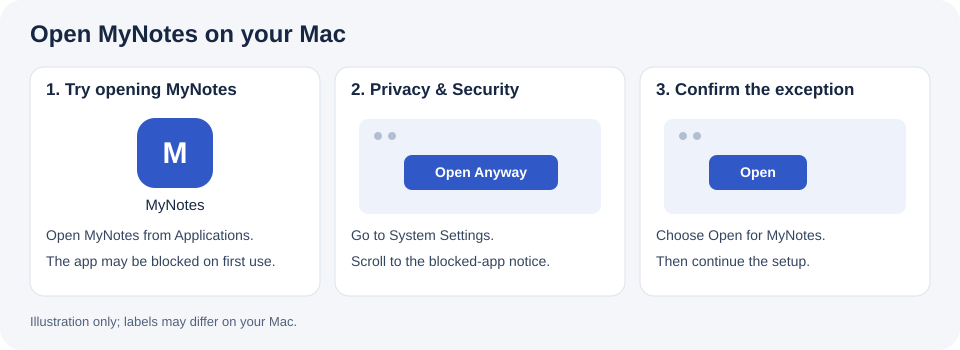

# MyNotes + Capture

Preview **0.2.20** adds a folder-based recording library, recoverable local transcription and stable Word updates with undo. See [update notes](docs/UPDATES.md).

Record lectures and turn audio, slides and personal notes into Word study handouts with editable equations. Capture is included; you do not need a separate download.

English | [Italiano](README.it.md)

## Get MyNotes for Mac

**Mac with Apple Silicon (M1 or newer), macOS 14+, internet for setup, and a usable Codex, Agy or Claude Code CLI account.**

**MyNotes 0.2.20 is available as a prerelease for continued testing.**
[Download the Apple Silicon DMG](https://github.com/gabrizanni/mynotes/releases/download/v0.2.20/MyNotes-0.2.20-macOS-arm64.dmg) · [Release notes, checksums and known limitations](https://github.com/gabrizanni/mynotes/releases/tag/v0.2.20).

1. Open the downloaded `.dmg`.
2. Drag **MyNotes** into **Applications**.
3. Open **MyNotes**, follow setup, and click **Open chat**.

The setup prepares Python, local transcription and the Word tools for you. You do not need Python, Homebrew or Xcode beforehand. Choose Codex, Agy or Claude Code; if it is missing, MyNotes opens its official installation guide and lets you retry. Provider access and any subscription are managed by that provider.

Claude Code requires an eligible plan or API access with credits. Claude Free does not include the CLI, even with Haiku. [Claude plans](https://claude.com/pricing).

### If macOS blocks opening

This candidate is not notarized by Apple and uses an ad-hoc signature. After trying to open MyNotes, go to **System Settings → Privacy & Security**, scroll to the blocked-app notice, choose **Open Anyway**, and confirm **Open**. The wording can differ across macOS versions or managed Macs. [Apple's instructions](https://support.apple.com/102445).



[Installation and troubleshooting](docs/INSTALL.md) · [First use](docs/ONBOARDING.md)

## Your first conversation

Before opening the chat, choose its language and optionally a model in the app: the same choice applies to chat and notes. MyNotes briefly introduces itself and asks about your background. It then asks two questions together about course context and note style; answer in one free-form message. Course preferences are saved and reused for later lessons. Then link audio and materials. You can drag files into Terminal. MyNotes proposes `~/Documents/MyNotes` for recordings, materials and handouts. Its private configuration and database stay in Application Support. Existing folders can be connected without moving their contents.

Start with **standard** quality and the built-in handout style. Change preferences later when you need them; model names and reasoning settings are optional.

To configure recording, say **“Here is my calendar; set up the recordings.”** The agent previews the lessons, asks you to confirm the schedule, then guides you through microphone permission and a short recording with playback. Capture stays disabled until you enable it. A valid file plus your listening confirmation establishes that the microphone test worked.

Capture records with the chat closed; the Mac must be on and awake, with its lid open. It saves audio and does not generate notes automatically. [Capture controls and limitations](docs/CAPTURE.md).

Ask **“Prepare notes for the first lecture from this audio and these slides.”** The agent prepares sources, generates and checks the notes, then updates the same Word handout with a safety backup. Ask for preview-first mode if you prefer approval. You can ask to undo the last update.

Later, open MyNotes again or use:

```sh
mynotes          # chosen agent
mynotes codex
mynotes agy
mynotes claude
mynotes setup   # revisit setup
mynotes doctor --json
```

## Where your data goes

Recording and transcription run locally. Note generation can send transcript text, selected course materials and relevant visuals to your chosen AI provider through its CLI. The provider's account, permissions, policies and possible usage charges apply. MyNotes does not provide its own account or store provider credentials in course configuration. [Privacy details](docs/PRIVACY.md).

## Developers

```sh
git clone https://github.com/gabrizanni/mynotes.git
cd mynotes
uv sync --locked
uv run pytest
uv run python scripts/check_public_tree.py
uv run python scripts/build_dmg.py
```

Build tools are required only on the packaging machine. The release builder compiles the native setup, Capture and local transcription executable, and bundles locked runtime inputs. The user installs the compiled result.

The usual pipeline is `prepare → generate → update`; `build` and `publish` remain available separately for preview-first work. It retains source provenance, uses JSON contracts for candidates, writes editable Word equations, and guards publication against concurrent changes and duplicate lectures. [Models and coordinated generation](docs/GENERATION.md) · [Script reference](scripts/README.md) · [Validation evidence and pending acceptance](docs/VALIDATION.md) · [Updates and rollback](docs/UPDATES.md).

[MIT license](LICENSE) · [Third-party notices](THIRD_PARTY_NOTICES.md) · [Gabriele Zanni](https://github.com/gabrizanni)
